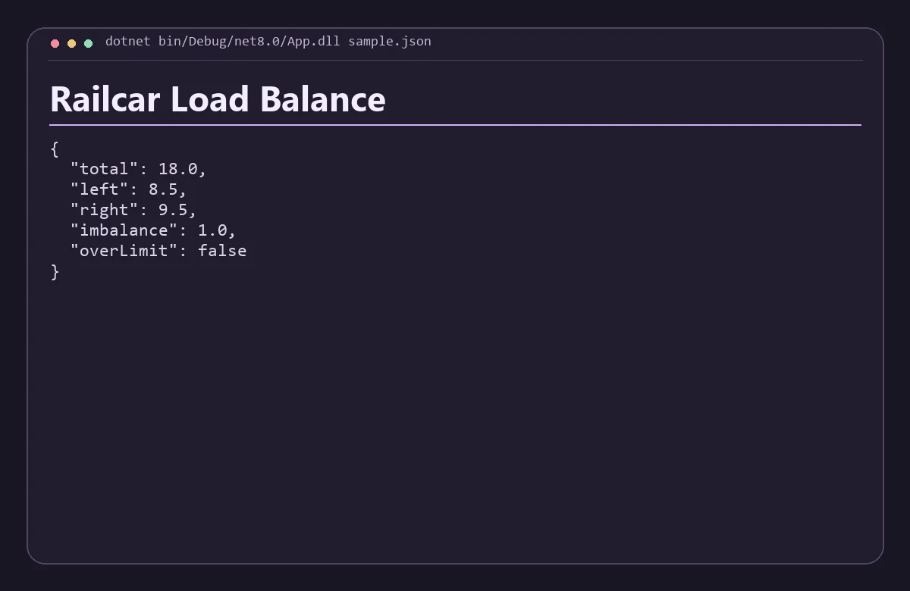

# Railcar Load Balance

Calculate total load, left-right imbalance and axle estimates from positioned cargo.



## Run

Install .NET 8 SDK and runtime. Run these commands from the repository root.

```sh
dotnet build --nologo
dotnet bin/Debug/net8.0/App.dll sample.json
```

Replace `sample.json` with a JSON file following the same structure. The app prints a JSON report to standard output.

Weights are nonnegative. Cargo positions range from 0 at the first support to 1 at the second. This is a two-support statics model for synthetic or exploratory inputs.

## Verify

Run `python check.py` with Python 3.11 or newer after the build step when applicable. The check verifies the bundled scenario and confirms that an invalid input returns an error.
